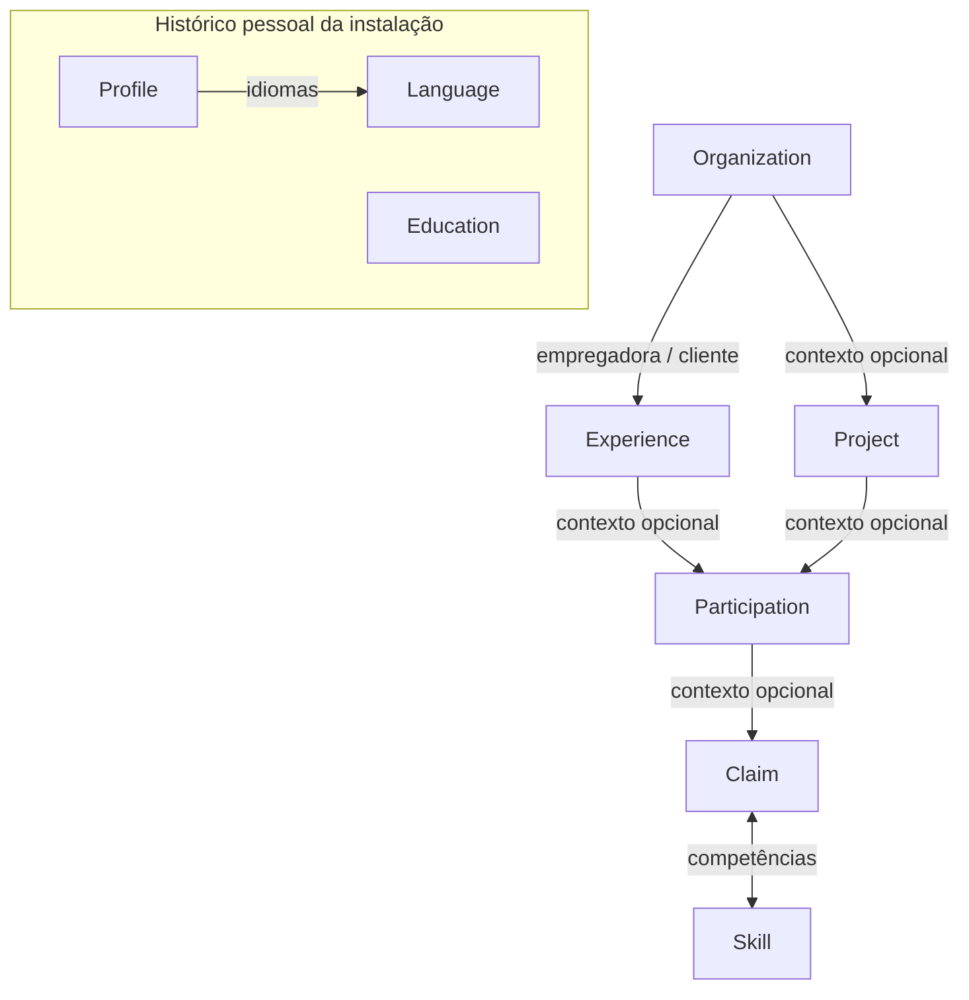

# Modelo de Career Knowledge

Use esta referência quando precisar decidir que registro representa uma informação ou como relacioná-la ao histórico existente.

## Registros

| Registro | Use para | Relações importantes |
| --- | --- | --- |
| `Profile` | Dados pessoais e links profissionais do usuário. Há no máximo um perfil. | `Language` pertence ao perfil. |
| `Organization` | Uma organização reutilizável pelo nome. | Pode ser empregadora, cliente de uma `Experience` ou contexto de um `Project`; empregador e cliente podem ser organizações diferentes. |
| `Experience` | Um vínculo profissional, com função e tipo de contratação em texto livre. | Exige uma organização empregadora; pode ter um cliente. Pode contextualizar várias `Participation`s. |
| `Project` | Um projeto profissional ou pessoal. | Pode ter uma organização como contexto, que não precisa ser sua proprietária legal. Pode contextualizar várias `Participation`s. |
| `Participation` | O contexto de uma atuação, atividade ou conjunto de responsabilidades. | Deve estar ligada a uma `Experience`, a um `Project` ou a ambos. A mesma combinação de experiência e projeto não deve ser cadastrada novamente. |
| `Claim` | Um fato profissional que possa ser usado como evidência de experiência ou competência. | Pode estar ligado a uma `Participation` ou ser independente. Pode ter várias `Skill`s, e uma `Skill` pode estar associada a várias claims. |
| `Skill` | Uma competência do catálogo reutilizável. | Relacione-a às `Claim`s que dão suporte ao uso dessa competência. Pesquise o catálogo antes de criar. |
| `Education` | Formação, curso ou certificação. | É um registro do histórico pessoal, sem vínculo obrigatório com `Organization` ou `Profile`. O tipo é graduação (`DEGREE`), curso (`COURSE`) ou certificação (`CERTIFICATION`). |
| `Language` | Um idioma e sua proficiência. | Pertence ao perfil único. A proficiência usa `BASIC`, `INTERMEDIATE`, `ADVANCED`, `FLUENT` ou `NATIVE`. |

## Como modelar uma informação

- Registre a relação de trabalho em `Experience`. Se o usuário trabalhava para uma consultoria atendendo um cliente, a consultoria é a empregadora e a outra organização é o cliente.
- Registre o projeto em `Project` quando ele tiver identidade própria no histórico. Use `Participation` para descrever o que o usuário fez em um vínculo profissional, em um projeto, ou nos dois. Não transforme cada tarefa em uma nova experiência ou projeto.
- Registre resultados, entregas, responsabilidades ou outros fatos profissionais em `Claim`. Associe a participação correspondente quando conhecida; não crie uma relação apenas para preencher um campo.
- Associe `Skill`s a fatos que sustentem essa competência. Não trate uma tecnologia mencionada sem contexto como prova automática de proficiência.
- Mantenha formação e idiomas em seus próprios registros. Não os converta em projetos ou claims só para encaixá-los na busca.
- Use os IDs devolvidos pelas ferramentas MCP para relacionar registros; não invente IDs nem dependa de nomes duplicados para representar relações.

## Relações em resumo

Uma `Participation` sem experiência continua válida se estiver ligada a um projeto; uma participação ligada a uma experiência não precisa de projeto. Uma `Claim` sem participação também é válida. Não crie registros-pai artificiais apenas para permitir uma associação.

## Busca vetorial

O índice vetorial é uma projeção técnica de `Claim`s, `Participation`s com descrição e `Education`s. Ele não é o histórico canônico nem um tipo de registro a criar. Use os resultados de busca para localizar fontes e, antes de usar ou alterar uma delas, leia a entidade correspondente: `Claim`, `Participation` ou `Education`.
