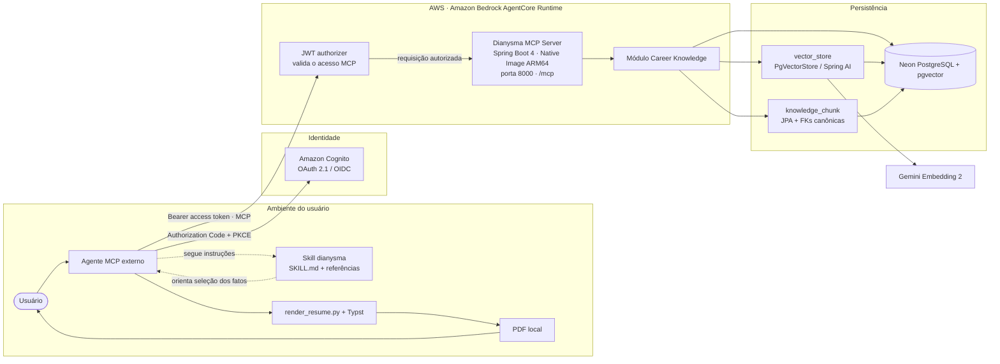

# Dianysma — arquitetura

**Versão:** 2.0 · **Data:** 12/10/2026<br>
**Direção:** servidor MCP privado de conhecimento profissional, acompanhado pela skill local `dianysma`.<br>
**Estado:** arquitetura em implementação; detalhes de domínio e infraestrutura ainda podem mudar.

## 1. Objetivo e escopo

O Dianysma armazena, organiza e recupera conhecimento profissional pessoal para agentes externos. O backend é um servidor MCP; o agente e a skill ficam no ambiente do cliente. O servidor não hospeda um agente LLM próprio.

O único domínio do backend é **Career Knowledge**: perfil, organizações, experiências, projetos, participações, claims, competências, formação, idiomas e suas projeções para busca vetorial.

O frontend Angular, a API REST de negócio e o módulo Job Discovery foram removidos. Pesquisas de vagas acontecem sob demanda no próprio agente, que pode comparar os resultados com fatos recuperados pelo MCP. Currículos e PDFs continuam sendo gerados localmente pela skill.

## 2. Componentes e fluxo

O diagrama fonte também está em [`architecture-components.mmd`](architecture-components.mmd).



## 3. Limites de responsabilidade

| Componente | Responsabilidade |
| --- | --- |
| Agente externo | Pesquisar oportunidades com ferramentas próprias, usar o MCP e seguir as instruções da skill. |
| Skill `dianysma` | Orientar consultas e alterações de Career Knowledge, seleção de claims, preparação para entrevistas e composição de currículos. |
| `render_resume.py` + Typst | Gerar localmente um PDF a partir dos dados que o agente selecionou e estruturou. |
| AgentCore Runtime | Expor o runtime MCP e validar os JWTs de entrada conforme a configuração de OAuth. |
| Servidor Spring | Expor ferramentas MCP e aplicar os serviços e regras de Career Knowledge; não executa agentes nem pesquisa vagas. |
| Neon PostgreSQL | Manter entidades canônicas e as tabelas de indexação vetorial. |
| Gemini Embedding 2 | Gerar embeddings usados na busca semântica; não é um agente de chat hospedado pelo Dianysma. |

## 4. Organização do backend

O backend é uma aplicação Spring organizada por domínio, com o pacote `knowledge` para o Career Knowledge. O transporte MCP é a interface de entrada do sistema e chama os serviços de aplicação. Não há API REST de negócio.

Filtros de consulta serão definidos junto com o contrato das ferramentas MCP. RSQL JPA Specification não faz parte do build atual; podemos avaliar uma implementação quando os casos de busca estiverem definidos.

```text
app/src/main/java/io/github/wskr00/dianysma/
├── core/
│   └── audit/
└── knowledge/
    ├── domain/
    │   └── enums/
    ├── service/
    ├── repository/
    └── controller/
        └── mcp/
```

O código atual já contém as entidades de `knowledge/domain`; as pastas de serviço, repositório e adaptador MCP serão preenchidas durante a implementação. `core/audit` contém a superclasse `Auditable` compartilhada. A modelagem está detalhada em [`career-knowledge-class-diagram.md`](career-knowledge-class-diagram.md).

## 5. Career Knowledge e busca vetorial

O modelo de domínio permanece o descrito no diagrama de classes:

- `Profile` é o perfil pessoal único da instalação; `Language` se relaciona com ele.
- `Organization`, `Experience` e `Project` representam organizações, vínculos profissionais e projetos.
- `Participation` representa o contexto de uma atuação e pode se relacionar a uma experiência, um projeto ou ambos.
- `Claim` guarda fatos profissionais. Uma claim pode existir sem participação.
- `Skill` se relaciona com `Claim` por `claim_skill` (N:N).
- `Education` guarda formação, cursos e certificações.
- `KnowledgeChunk` relaciona uma fonte canônica com seu documento vetorial.

`KnowledgeVectorStore` será uma fachada por composição: usa o `PgVectorStore` do Spring AI para embeddings e similaridade e um repositório JPA para as FKs e o contexto relacional. A tabela `vector_store` contém `content`, `metadata` e `embedding`; `knowledge_chunk` contém o ID compartilhado, a FK para exatamente uma fonte, o hash, o modelo e a data da indexação. As fontes de domínio continuam sendo a verdade canônica.

O modelo de embedding decidido é Gemini Embedding 2 com 1536 dimensões, usando índice HNSW e distância cosseno no pgvector. O `PgVectorStore` terá `initialize-schema=false`; Flyway cria o schema técnico e as constraints PostgreSQL que JPA não expressa. A migração inicial continua em `V1__initial_schema.sql` enquanto o projeto ainda está em desenvolvimento; o banco local pode ser recriado quando essa V1 mudar.

## 6. Skill e fluxos locais

A skill é executada no cliente do agente e não no AgentCore. A estrutura alvo é:

```text
skill/
├── SKILL.md
├── references/
├── scripts/
│   └── render_resume.py
└── assets/
    └── resume.typ
```

O `SKILL.md` orienta o agente a recuperar e manter conhecimento pelo MCP, escolher claims verdadeiras para um currículo, apoiar preparação para entrevistas e executar a renderização local. A skill não acessa PostgreSQL diretamente e não contém mais funcionalidades de coleta de vagas.

**Estado do checkout:** não há atualmente uma pasta `skill/` versionada neste repositório. A arquitetura preserva essa capacidade como componente a ser incorporado; não havia arquivos da skill neste checkout para migrar.

## 7. Execução e infraestrutura

| Parte | Tecnologia / decisão atual |
| --- | --- |
| Runtime | Amazon Bedrock AgentCore Runtime |
| Aplicação | Java 25, Spring Boot 4.1.1, Spring AI |
| Artefato | GraalVM Native Image para ARM64; container escuta na porta 8000 |
| Transporte MCP | Stateless Streamable HTTP em `/mcp` |
| Identidade | Amazon Cognito como authorization server OAuth/OIDC; login Google pode ser federado |
| Banco | Neon PostgreSQL com pgvector |
| Embeddings | Gemini Embedding 2, 1536 dimensões |
| Filtros de consulta | A definir junto com as ferramentas MCP |
| Desenvolvimento local | Docker Compose com PostgreSQL e pgvector |

O container do AgentCore chama o servidor Spring na porta 8000. O banco permanece externo no Neon. `compose.yaml` é somente para o banco local; não hospeda backend nem frontend.

### Integração com AWS

A aplicação Java não precisa de Spring Cloud AWS nem do AWS SDK para autenticação. O Cognito emite os tokens OAuth; o AgentCore Runtime valida os JWTs na entrada pública; e o Spring Security atua como OAuth2 Resource Server dentro da aplicação.

## 8. Segurança e autenticação

O fluxo previsto é:

1. O cliente MCP inicia Authorization Code com PKCE no Cognito, incluindo `resource=MCP_RESOURCE_URI` conforme o resource indicator do MCP.
2. Cognito autentica a conta permitida e emite um access token cujo `aud` identifica esse recurso e cujo `scope` contém permissões de leitura e/ou escrita.
3. O cliente envia o bearer token ao endpoint MCP do AgentCore Runtime.
4. O authorizer do Runtime valida o emissor, a audience, o cliente e os scopes antes de encaminhar a chamada. A configuração do Runtime deve encaminhar o header `Authorization` ao container.
5. Spring Security valida novamente assinatura, validade, emissor e audience do access token, exige um scope de Career Knowledge e não cria sessão.

O User Pool deve permitir somente a conta autorizada; o login Google pode ser configurado como provedor federado. A restrição de identidade fica na configuração do Cognito e do AgentCore, sem usuário ou e-mail hardcoded no código. O backend não implementa authorization server, login, cookies ou sessão. A validação no Spring Security também protege a aplicação caso uma chamada alcance o container sem passar pelo authorizer público.

Há dois metadados distintos. O Cognito publica o OpenID Provider Metadata em `<COGNITO_ISSUER_URI>/.well-known/openid-configuration`, com os endpoints do authorization server e as chaves públicas. O AgentCore Runtime, como entrada pública do servidor MCP, publica o Protected Resource Metadata e o anuncia no desafio `WWW-Authenticate` com `resource_metadata`. O Spring Security não duplica essa metadata: no container, ele atua somente como OAuth2 Resource Server, validando os tokens encaminhados pelo Runtime. Em produção, o endpoint do container não deve ser exposto diretamente.

Os scopes Cognito esperados são `dianysma/knowledge.read` e `dianysma/knowledge.write`. O filtro HTTP exige pelo menos um deles para chamadas protegidas; quando as ferramentas MCP forem implementadas, cada operação de leitura ou escrita deve também aplicar sua autorização no método de aplicação correspondente.

`COGNITO_ISSUER_URI` deve ser o issuer do User Pool (por exemplo, `https://cognito-idp.<region>.amazonaws.com/<user-pool-id>`). `MCP_RESOURCE_URI` deve ser exatamente o identificador HTTPS do servidor MCP usado no parâmetro OAuth `resource`, na audience validada pelo Cognito, AgentCore e Spring Security.

## 9. Compatibilidade MCP

O alvo atual é MCP `2025-11-25`, compatível com a linha MCP Java SDK 2.x usada pelo Spring AI 2.x. O servidor usará Stateless Streamable HTTP: cada chamada é independente e não mantém sessão; recursos bidirecionais como sampling e elicitation não fazem parte do desenho atual.

A especificação MCP `2026-07-28` é posterior ao alvo suportado pela stack escolhida. Não implementaremos o protocolo manualmente nem anunciaremos suporte a essa versão. A interoperabilidade entre ChatGPT, AgentCore Runtime e Spring AI precisa ser validada antes da implantação; se um cliente exigir operações fora do suporte do SDK 2.x, isso será uma decisão de compatibilidade separada.

## 10. Configuração local

Copie `.env.example` para `.env` e ajuste as credenciais locais. O Compose lê `DATABASE_NAME`, `DATABASE_USER` e `DATABASE_PASSWORD`; a aplicação lê também `DATABASE_HOST`, `DATABASE_PORT`, `GEMINI_API_KEY`, `COGNITO_ISSUER_URI` e `MCP_RESOURCE_URI`. Os dois últimos são obrigatórios para iniciar o servidor protegido. No ambiente do AgentCore, os valores de produção devem vir de configuração segura do runtime.

## 11. Decisões ainda abertas

- Contratos, nomes, schemas e limites das ferramentas MCP de leitura, escrita, exclusão e busca semântica.
- Comportamento de OAuth Cognito/AgentCore com ChatGPT e outros clientes MCP, incluindo descoberta e configuração de audience/scopes.
- Provisionamento e recuperação segura de segredos no runtime.
- Estratégia de reindexação retomável e consistência transacional entre JPA e `PgVectorStore`.
- Pipeline de build e publicação do container nativo ARM64 para AgentCore.
- Estrutura e conteúdo versionados da skill `dianysma`.

## 12. Documentos relacionados

- [`career-knowledge-class-diagram.md`](career-knowledge-class-diagram.md) — entidades, regras e persistência vetorial.
- [`architecture-components.mmd`](architecture-components.mmd) — diagrama de componentes editável.
