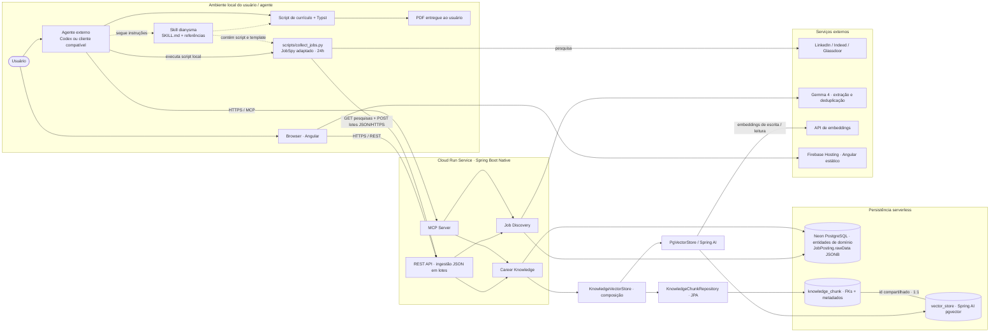
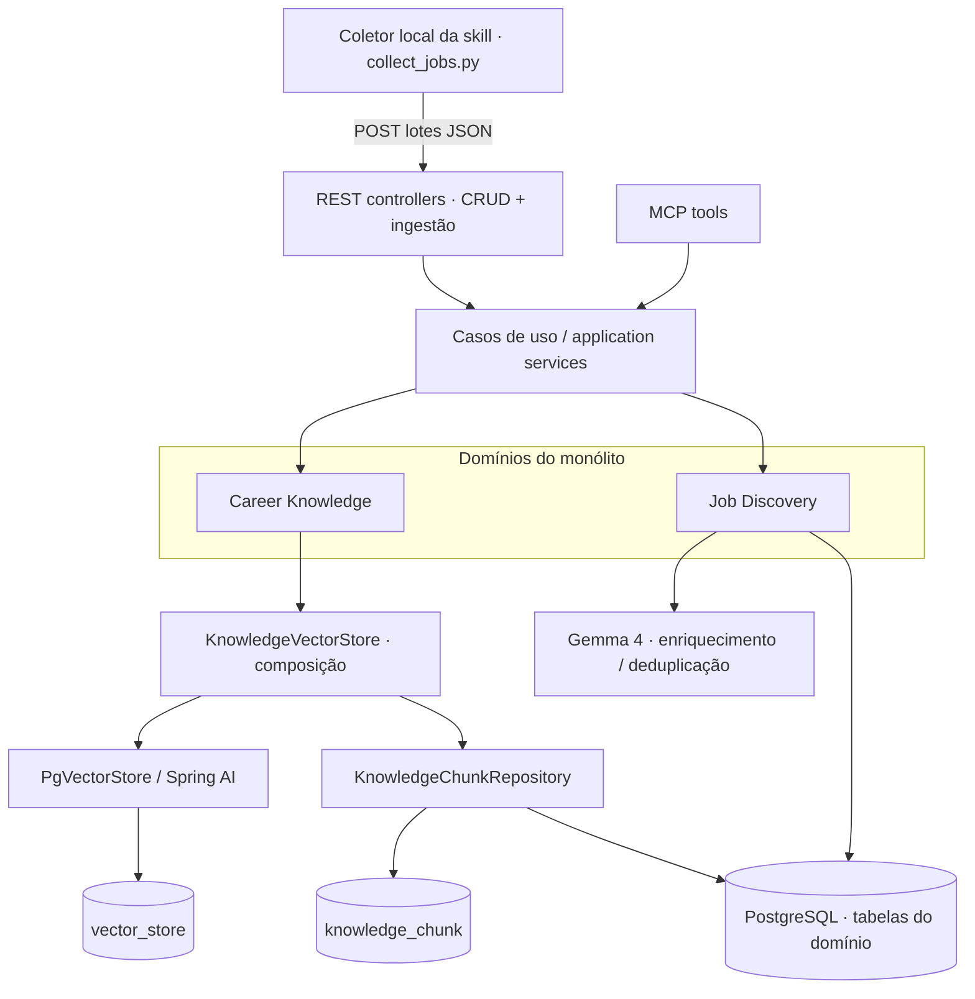
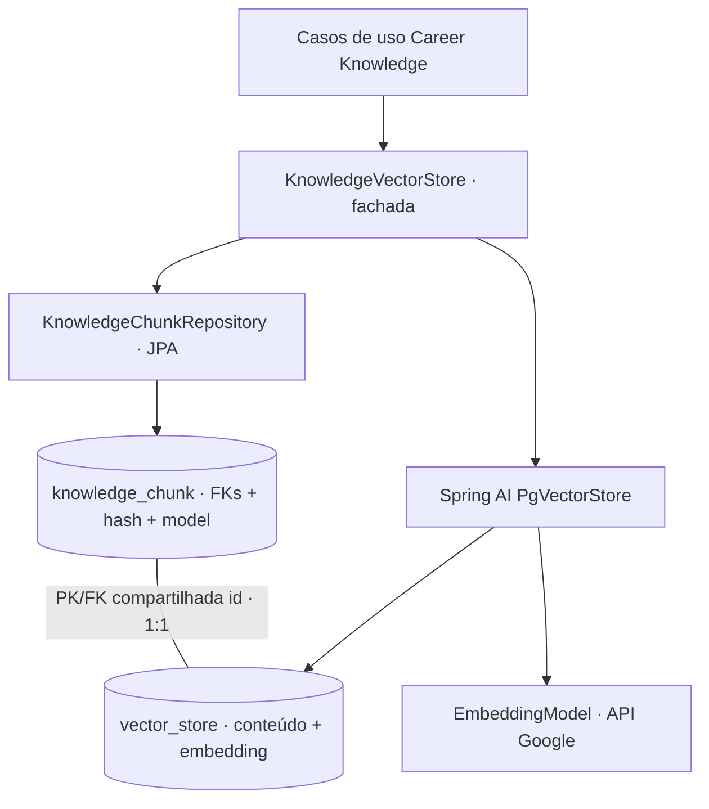
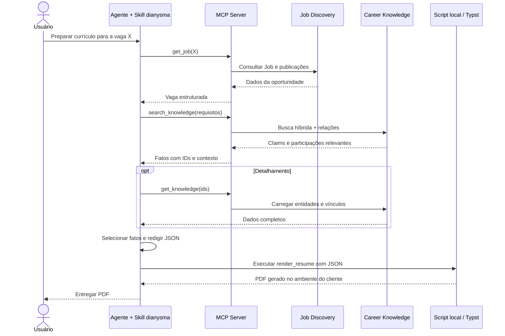
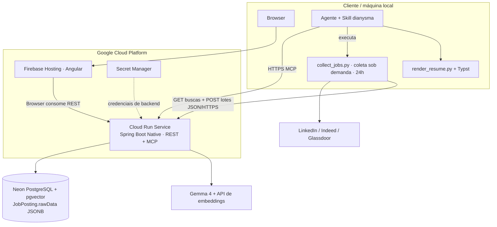

# Dianysma — Arquitetura geral

**Versão:** 1.2 (coleta local por skill; ingestão REST; PgVectorStore por composição)\
**Data:** 11/10/2026\
**Estado:** proposta conceitual; arquitetura, modelagem e skills ainda podem mudar.\
**Escopo:** aplicação pessoal, single-user, de descoberta de vagas e gestão de conhecimento profissional, integrada a agentes por MCP e a uma skill cliente planejada como **Dianysma**.

## 1. Objetivo e limites

O **Dianysma** oferece duas capacidades centrais: (1) descobrir, estruturar, armazenar e consultar vagas de emprego no Brasil; (2) armazenar experiências, projetos, realizações e competências profissionais de modo pesquisável para consumo por agentes de IA. O sistema **não** realiza matching periódico entre perfil e vagas. A seleção da oportunidade é feita pelo usuário ou, sob demanda, pelo agente externo.

A geração de currículo **não** é um terceiro módulo de domínio do backend: é um fluxo da **skill `dianysma`**, executada no ambiente do agente, utilizando dados do MCP e um script/template de renderização de PDF no próprio cliente. O backend não persiste, hospeda ou gera currículos em PDF.

## 2. Diagrama de componentes — visão principal

Este é o diagrama mais adequado para compreender os limites de execução e responsabilidades. As setas representam comunicação ou uso, não dependência obrigatória de infraestrutura específica.



### Fronteiras principais

| Elemento                         | Responsabilidade                                                                                                           | Não é responsável por                                          |
| -------------------------------- | -------------------------------------------------------------------------------------------------------------------------- | -------------------------------------------------------------- |
| **Frontend Angular**             | Listar/consultar vagas, buscas e dados profissionais; operações manuais via REST                                           | Gerar PDF ou executar a skill                                  |
| **Backend Spring Boot Native**   | Disponibilizar REST/MCP; validar regras de domínio; pesquisar e persistir dados                                            | Redigir currículo; hospedar PDF; executar a skill              |
| **Career Knowledge**             | Manter fatos profissionais e projeções vetoriais pesquisáveis                                                              | Matching automático de vagas                                   |
| **Job Discovery**                | Ingestão de anúncios coletados localmente, extração assistida por LLM, deduplicação e consulta                                                         | Selecionar vagas para o usuário                                |
| **Skill dianysma**   | Orientar o agente no uso do Dianysma, inclusive coletar vagas, ler/escrever conhecimentos e gerar currículos | Persistir conhecimento autonomamente, sem MCP                  |
| **Script de currículo da skill** | Validar JSON, usar template de código e produzir PDF no ambiente de execução do agente                                     | Inferir experiências, chamar banco diretamente ou hospedar PDF |
| **`collect_jobs.py` da skill** | Pesquisar vagas com JobSpy adaptado em LinkedIn, Indeed e Glassdoor (24h) e enviar lotes JSON à API | Executar IA, escrever diretamente no banco, ser um servidor ou agendador |

## 3. Organização lógica do backend

Arquitetura proposta: **monólito modular**, com dois módulos de domínio independentes. REST e MCP são adaptadores de entrada para os **mesmos serviços de aplicação**; não se duplicam regras de negócio. A coleta ocorre somente no script Python da skill, no cliente; os anúncios chegam a Job Discovery por um endpoint REST autenticado de ingestão. **Não existe entrypoint Java de batch, Cloud Run Job ou agendador de coleta no backend.**



**Tecnologias preferidas (a validar em prova técnica):** Java 25, Spring Boot 4, GraalVM Native Image, Spring Security, Spring AI para MCP/embeddings/structured output e `PgVectorStore` por composição, Spring Data JPA para `KnowledgeChunkRepository`, Angular, PostgreSQL com pgvector, Flyway e Docker. Evitar dependências desnecessárias, microsserviços e orquestração Kubernetes no MVP.

### 3.1 Career Knowledge

Entidades e modelagem detalhada: [`Career Knowledge/career-knowledge-class-diagram.md`](Career%20Knowledge/career-knowledge-class-diagram.md).

- **Profile:** dados de apresentação profissional em um registro único.
- **Organization, Experience, Project:** organizações, vínculos (empregador/cliente) e projetos reutilizáveis.
- **Participation:** contexto de uma atuação; pode apontar para uma experiência, um projeto ou ambos, exigindo pelo menos uma relação.
- **Claim:** afirmação factual, com `participationId` opcional; pode existir independentemente.
- **Skill:** competências associadas a Claims por uma relação N:N; a tabela de junção `claim_skill` não possui embedding próprio.
- **Education, Language:** formação, cursos, certificações e idiomas.
- **VectorDocument (`vector_store`):** tabela técnica padronizada do Spring AI `PgVectorStore`, com `id`, `content`, `metadata` e `embedding`. Contém texto contextualizado e vetor derivado.
- **KnowledgeChunk (`knowledge_chunk`):** tabela técnica relacional separada, com `id` (PK e FK 1:1 para `vector_store.id`), `participationId`, `claimId`, `educationId`, `hash`, `model` e `indexedAt`. Exige exatamente **uma** FK de origem; mantém integridade referencial real, inclusive para Claims independentes da Participation.
- **KnowledgeVectorStore:** fachada/serviço por **composição**: usa o `PgVectorStore` para embeddings e similaridade e um `KnowledgeChunkRepository` JPA para persistir as FKs e recuperar contexto. Nenhuma herança de `PgVectorStore` nem reimplementação das operações vetoriais.

**Estratégia vetorial:** indexar Participation e Claim, e Education quando útil. Textos dos documentos incluem contexto derivado por relações SQL (organizações, experiências, projetos e skills), mas o `KnowledgeChunk` referencia uma única entidade de origem. `PgVectorStore` executa `add`/`similaritySearch`; o serviço recupera `KnowledgeChunk` por ID e percorre seus relacionamentos. Manter busca textual como complemento para nomes e versões exatos. `hash` identifica o conteúdo indexado e `model` permite identificar mudanças do modelo. Usar Gemini Embedding 2 a 1536 dimensões; qualquer mudança de modelo ou dimensão exige reindexação completa e idempotente, que deve sobreviver ao scale-to-zero.

### 3.1.1 Composição e persistência de embeddings



**Escrita:** montar o texto contextualizado, gerar um ID estável para o `Document`, gravar em `vector_store` via Spring AI e salvar `knowledge_chunk` com esse mesmo ID e exatamente uma FK de origem. Usar uma transação compartilhada para os dois writes quando as integrações a suportarem; testar rollback e atualização com PostgreSQL real antes de assumir atomicidade.

**Leitura:** `similaritySearch(query)` retorna documentos com ID. Buscar os `KnowledgeChunk` correspondentes em lote para obter as FKs e carregar o contexto relacional. A coluna `metadata` da `vector_store` não substitui essas FKs.

**Schema:** o Flyway cria ambas as tabelas e suas constraints, com `vector_store` compatível com Spring AI e `initialize-schema=false`. A relação 1:1 é uma FK no PostgreSQL baseada no `id` compartilhado; `vector_store` não é uma entidade JPA porque `PgVectorStore` a acessa via JDBC. O modelo escolhido é Gemini Embedding 2 com 1536 dimensões; `vector_store.embedding` usa `vector(1536)` e índice HNSW com distância cosseno. O texto de documentos e consultas deve usar os prefixos de tarefa de retrieval recomendados pelo Gemini Embedding 2. Apagar fontes de domínio exige também limpar o índice; `knowledge_chunk` é derivado. Não existem colunas geradas por JSON nem uma segunda cópia de `content` e `embedding` na tabela relacional.

### 3.2 Job Discovery

Entidades e modelagem detalhada: [`Job Discovery/job-discovery-class-diagram.md`](Job%20Discovery/job-discovery-class-diagram.md).

- **Job:** oportunidade canônica consolidada.
- **JobRequirements, JobCompensation, JobLocation:** dados satélites 1:1 e opcionais; requisitos/benefícios armazenados como listas de strings.
- **JobPosting:** publicação individual identificada por portal de origem e URL normalizada, com **`rawData` (`raw_data JSONB`)** contendo os dados enviados pelo coletor e `processingStatus` (`PENDING`, `COMPLETED`, `FAILED`). `jobId` é opcional até associação. Não há necessidade de HTML bruto em Object Storage no MVP.
- **JobSearch:** busca textual por palavras-chave e país (Brasil como padrão), com **`lookbackHours = 24` por padrão** e flag de habilitação. Pode ser consultada pelo script local via REST.
- **CollectionRun:** execução local de uma `JobSearch` em **um portal de origem** (`LINKEDIN`, `INDEED`, `GLASSDOOR`), recebida e registrada pelo backend, com horários e status global, sem contadores persistidos. Reenvios usam o mesmo ID de execução.
- **CollectionRunPosting:** tabela associativa N `(collectionRunId, jobPostingId)`; fatos observados que permitem calcular por SQL quantos anúncios apareceram, quais são inéditos e quais reapareceram.

**Deduplicação são dois conceitos diferentes:** a mesma publicação aparecendo em mais de uma execução (N CollectionRun↔JobPosting) e diferentes publicações representando a mesma vaga (vários JobPosting→um Job). A IA auxilia a segunda identificação, primeiro filtrando candidatos com identificadores/URL, empresa e texto; incerteza não deve provocar fusão irreversível.

**Estado de coleta:** `CollectionRun.status` descreve a execução local; `JobPosting.processingStatus` descreve extração e associação no backend. O desenho atual não registra tentativas que falharam antes de existir um JobPosting; para esse caso, usar logs ou estender o modelo futuramente. `CollectionRunPosting` continua sendo a tabela associativa N:N entre runs e anúncios.

## 4. Skill cliente — Dianysma

A skill tem **o mesmo nome da aplicação**, Dianysma, e cobre a aplicação inteira. A criação de currículo é **uma das capacidades da skill**, não seu único objetivo.

**Organização planejada (não implementada nesta documentação):**

```text
skills/
└── dianysma/
    ├── SKILL.md
    ├── references/
    │   ├── workflows.md
    │   ├── career-knowledge.md
    │   ├── job-discovery.md
    │   ├── resume-guidelines.md
    │   └── resume-schema.json
    ├── scripts/
    │   ├── render_resume.py
    │   └── collect_jobs.py
    └── assets/
        └── resume.typ
```

O `SKILL.md` ensina o agente quais ferramentas MCP usar, como consultar vagas, como cadastrar e atualizar fatos profissionais, como interpretar os relacionamentos, e como selecionar Claims reais ao preparar um currículo. O script `render_resume.py` e o template local geram o PDF a partir de JSON estruturado. O **`collect_jobs.py`** integra, dentro da própria skill, as rotinas necessárias inspiradas no JobSpy para LinkedIn, Indeed e Glassdoor, com a licença aplicável preservada: é executado pelo agente no computador do usuário, consulta as buscas habilitadas pela API, coleta anúncios das últimas 24 horas e envia os dados por HTTPS. Não é um serviço nem requer timer ou systemd. O formato de instalação e a disponibilidade de execução de scripts dependem do cliente de agente; um cliente sem execução local de scripts não oferecerá necessariamente a geração de PDF.

**Fluxos orientados pela skill:**

1. **Coletar vagas:** quando solicitado pelo usuário, executar `scripts/collect_jobs.py`, que consulta os portais e envia lotes JSON para a API REST, sem abrir porta local.
2. **Explorar vagas:** listar pesquisas/vagas, consultar uma oportunidade selecionada e abrir URLs de publicação.
3. **Gerenciar conhecimento:** consultar detalhes, pesquisar semanticamente, adicionar/alterar experiências, participações e Claims via MCP; alterações devem respeitar integridade e evitar invenção de fatos.
4. **Gerar currículo:** consultar a vaga escolhida, recuperar Claims relevantes, compor JSON, validar e executar o script local, entregando PDF ao usuário.
5. **Outros fluxos futuros:** preparação para entrevistas, exploração de competências e assistência em candidaturas, sem alterar o backend quando bastarem ferramentas MCP existentes.

### 4.1 Fluxo de currículo — sem persistência



Os nomes das ferramentas (`get_job`, `search_knowledge`, `get_knowledge`) são **contratos ilustrativos**; serão fechados no desenho da API MCP. Nenhuma etapa exige tabela Resume ou endpoint de geração de PDF.

## 5. Coleta local e ingestão de vagas

### 5.1 Execução manual pela skill (janela de 24 horas)

```mermaid
sequenceDiagram
    actor User as Usuário
    participant Agent as Agente + Skill
    participant PY as collect_jobs.py local
    participant API as Spring Boot REST API
    participant SRC as LinkedIn / Indeed / Glassdoor
    participant DB as PostgreSQL
    participant AI as Gemma 4

    User->>Agent: Coletar vagas
    Agent->>PY: Executar script de coleta
    opt Processo pode sobreviver ao fim do turno
        Agent-->>User: Execução iniciada; finalizar turno sem esperar
    end
    PY->>API: GET pesquisas habilitadas
    API-->>PY: JobSearch (lookbackHours=24)
    loop Para cada pesquisa e portal
        PY->>SRC: Pesquisar vagas no portal
        SRC-->>PY: Dados disponíveis (sem garantia de cobertura total)
        PY->>API: POST lote JSON (runId, provider, postings.rawData)
        API->>DB: Upsert JobPosting por provider + URL
        API->>DB: Criar/reutilizar CollectionRun; vincular CollectionRunPosting
        opt Publicação nova ou reprocessamento relevante
            API->>API: Normalizar campos determinísticos
            opt Campos incompletos ou duplicação ambígua
                API->>AI: Extração / avaliação de equivalência
                AI-->>API: Dados estruturados
            end
            API->>DB: Criar/atualizar Job e satélites
        end
        PY->>API: Lote final + status da execução
        API->>DB: Finalizar CollectionRun
    end
```

**Contrato REST inicial (ilustrativo):** `GET /api/v1/job-searches?enabled=true` e `POST /api/v1/job-discovery/collections`. Cada POST recebe `runId`, `jobSearchId`, `provider`, `postings[]`, `finalBatch` e `status` ao concluir, quando aplicável. `JobPosting` recebe `url`, `publishedAt` (quando disponível) e `rawData`. O identificador de execução deve permanecer estável nos reenvios, sem criar novos anúncios ou novos vínculos. Os lotes são limitados em tamanho; o backend não recebe uma conexão contínua por todo o período da coleta.

**Responsabilidades:** o Python não chama modelos, não executa regras de merge de vagas, não grava no PostgreSQL e não precisa expor portas. O backend valida, normaliza, persiste, extrai e deduplica; o Angular apenas usa REST. Uma tentativa de coleta iniciada pelo agente é uma tarefa local sob demanda, **sem Cloud Scheduler, Cloud Run Job ou timer**. Se o ambiente do agente permitir criar um processo independente, ele pode confirmar o início e finalizar o turno; caso contrário, o término da sessão pode interromper o Python, e a skill não deve garantir execução em segundo plano.

### 5.2 Dados brutos, deduplicação e falhas

- `JobPosting.rawData` é **JSONB** (`raw_data`), com os dados recebidos do scraper (por exemplo, título, empresa, descrição e atributos disponíveis). Não é um documento HTML obrigatório nem uma chave para objeto externo.
- A deduplicação tem **dois níveis**: `(provider, url normalizada)` para a mesma publicação e associação de publicações diferentes ao mesmo `Job` para oportunidades equivalentes. Consultas SQL e campos determinísticos primeiro; Gemma 4 somente para extração ausente e ambiguidade relevante.
- `CollectionRun.provider` indica LinkedIn, Indeed ou Glassdoor; não indica JobSpy. Uma execução representa um portal para uma `JobSearch` e pode terminar `COMPLETED`, `PARTIAL` ou `FAILED`.
- Retentar lotes por falha de HTTP deve ser seguro via `runId`, upsert e `CollectionRunPosting` com PK composta. A transação por lote deve preservar a consistência de seus vínculos.
- Páginas com restrição de acesso, HTTP 429 ou falhas de coleta devem produzir execução parcial/falha sem forçar o acesso. A coleta local não altera os termos de uso das plataformas. Não assumir completude dos resultados nem perfeição do filtro temporal.
- `rawData` é entrada não confiável. Sanitizar/validar, limitar tamanho e definir retenção para evitar crescimento desnecessário do Neon; não guardar cookies, credenciais nem dados sensíveis da sessão. Prompt injection nas descrições não deve influenciar as instruções do backend.
- O MVP recebe lotes pequenos e executa o processamento no backend sem presumir que threads continuem após a resposta no Cloud Run. Se a inferência ficar longa, avaliar uma fila confiável no futuro, **não incluída na arquitetura atual**.

## 6. Infraestrutura — implantação proposta

A implantação inicial permanece serverless para minimizar custo ocioso. **Não há componente de coleta hospedado na nuvem**: a única execução do scraper é `collect_jobs.py` no ambiente do agente/usuário.



- **Cloud Run Service:** REST/MCP sob demanda, com escala a zero quando possível; também é a API de ingestão dos lotes JSON. Não depender de execução em background após responder uma requisição sem infraestrutura própria para isso.
- **Coletor local:** um único `scripts/collect_jobs.py` distribuído na skill, iniciado pelo agente quando solicitado. Não há daemon, systemd, agendador local, Cloud Scheduler nem Cloud Run Job.
- **Neon PostgreSQL + pgvector:** armazena dados relacionais, vetores do Career Knowledge e o `raw_data JSONB` dos anúncios. Controlar tamanho/retenção do JSONB.
- **Firebase Hosting:** entrega estática da aplicação Angular.
- **LLM externo no backend:** Gemma 4 para extração complementar e deduplicação ambígua; embeddings externos para Career Knowledge. O script local não usa IA. A geração de PDF continua sendo realizada pela skill.
- **Segredos:** o backend guarda credenciais no ambiente Cloud Run/Secret Manager. O script recebe uma credencial de ingestão apropriada em configuração local segura, nunca hardcoded nem commitada com a skill.

## 7. Interface e segurança

- REST e MCP expõem operações compatíveis dos domínios, invocando os mesmos casos de uso. A superfície de escrita MCP deve validar entidades e relações tão rigorosamente quanto a REST. O endpoint de ingestão REST também exige autenticação, validação, limites de tamanho e idempotência por execução.
- Acesso é privado para um único usuário; ainda assim, usar autenticação/autorização no REST e MCP remoto, TLS, gerenciamento de segredos e proteção dos dados profissionais. A escolha do provedor de identidade e dos mecanismos OAuth/OIDC será refinada na implementação.
- Não expor o banco nem o armazenamento de HTML diretamente aos agentes. O MCP entrega dados controlados e IDs para detalhamento, não credenciais.
- Proteger contra prompt injection nas descrições de vagas e sanitizar os dados submetidos aos modelos. `rawData` recebido de um script local não é automaticamente confiável; não persistir cookies, tokens ou dados de sessão do navegador.
- Usar migrações de esquema (Flyway), testes de integração com PostgreSQL/pgvector, logs de ingestão, tratamento de falhas e backups do banco. Testar reenvio de lotes, unicidade por URL e histórico de CollectionRun.
- A geração de PDF executada pela skill deve validar estrutura e texto antes do template e não executar código arbitrário fornecido por descrições de vagas.

## 8. Decisões explícitas / fora do escopo

| Decisão                                   | Consequência                                                                    |
| ----------------------------------------- | ------------------------------------------------------------------------------- |
| Single-user                               | Sem multi-tenancy e sem entidade User obrigatória no domínio                    |
| Dois módulos de domínio                   | Career Knowledge e Job Discovery apenas                                         |
| Coleta acionada pelo agente via script da skill | `collect_jobs.py` local, sem timers ou Cloud Run Job; procura LinkedIn/Indeed/Glassdoor nas últimas 24h |
| Brutos no PostgreSQL | `JobPosting.rawData` → `raw_data JSONB`; sem Object Storage para o MVP |
| Sem matching periódico                    | Usuário/agente escolhe vaga sob demanda                                         |
| Sem vetores para vagas no MVP             | Deduplicação por dados determinísticos + LLM em casos ambíguos                  |
| `CollectionRun` N `JobPosting`            | Histórico factual de reaparições; agregados por SQL, sem contadores armazenados |
| Skill `dianysma` (mesmo nome de produto) | Interface instrucional para toda a aplicação; currículo é uma funcionalidade    |
| PDF no cliente                            | Backend não possui Resume, renderizador, bucket de PDF ou endpoint de PDF       |
| Templates em código na skill              | Versionamento por arquivos locais, sem entidade Template                        |
| Spring Native/serverless                  | Compatibilidade de MCP, AOT e bibliotecas precisa de teste técnico       |
| Sem rastreamento completo de candidatura  | Não há Application, candidatura automática ou status de inscrição no MVP        |

## 9. Contratos e decisões ainda abertos

Estes itens **não** estão fechados e não devem ser tratados como implementados:

1. Nomes, contratos e paginação das ferramentas MCP de leitura/escrita, busca e consulta de vagas.
2. Provedor e política de autenticação para REST/MCP remoto, compatível com os clientes-alvo.
3. Suporte real de cada cliente ao carregamento de skills e à execução do script de geração do PDF.
4. Definir estratégia de reindexação persistente e retry; **Gemini Embedding 2 a 1536 dimensões, PgVectorStore por composição e duas tabelas estão decididos**.
5. Implementação robusta e permitida do código de coleta local inspirado no JobSpy, cobertura real de cada plataforma, limites/retenção de `rawData JSONB` e comportamento de execução independente quando suportado pelo agente.
6. Estratégia de merge conservador de anúncios equivalentes, tratamento de divergências e correção manual.
7. Definição exata de formatos do JSON do currículo e do template Typst da skill.
8. Preços, regiões e limites de Cloud Run/Neon/LLM; arquitetura de implantação ainda é uma **preferência**, não compromisso definitivo.
9. Contrato definitivo da ingestão REST em lotes, processamento em linha vs. eventual fila futura e autenticação do script cliente.

## 9.1 Convenções atuais de nome

| Uso | Nome |
| --- | --- |
| Nome de produto, títulos de documentação e UI | **Dianysma** |
| Classe principal Java atual | `DianysmaApplication` |
| Pacote Java atual | `io.github.wskr00.dianysma` |
| Nome do projeto Gradle e slug do repositório | `dianysma` |
| Nome/slug da skill | Planejado como `dianysma`; ainda pode mudar |
| Tabelas, colunas e migrações SQL | `snake_case`: `vector_store`, `knowledge_chunk` |
| Nomes de variáveis Java/TypeScript | `camelCase` |

O nome da skill e o desenho da arquitetura são propostas e podem mudar. A intenção atual é que a skill oriente os fluxos da aplicação, incluindo currículo.

## 10. Documentação relacionada

- [`career-knowledge-class-diagram.md`](career-knowledge-class-diagram.md) — diagrama de classes do primeiro domínio.
- [`job-discovery-class-diagram.md`](job-discovery-class-diagram.md) — diagrama de classes do segundo domínio.
- `architecture-components.mmd` — diagrama de componentes principal em Mermaid, também salvo separadamente para edição direta.

