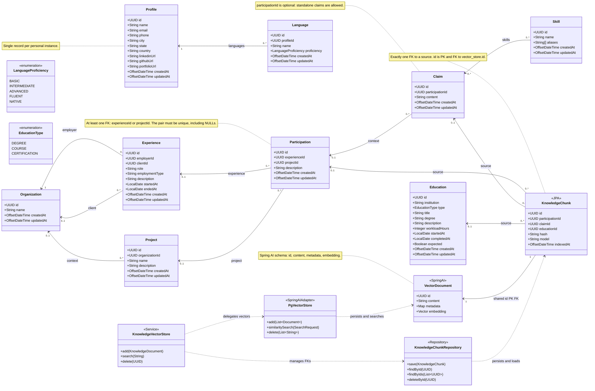
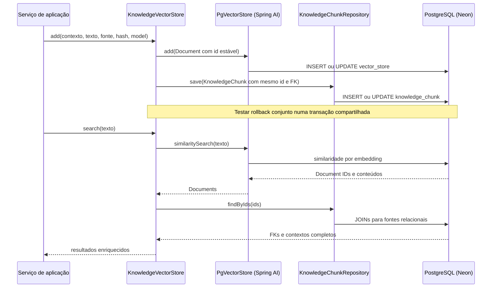

# Dianysma — Diagrama de Classes: Career Knowledge

**Versão:** 1.1 · **Data:** 10/10/2026  
**Escopo:** primeiro módulo (conhecimento profissional pessoal), incluindo perfil, duas tabelas de indexação vetorial e composição sobre Spring AI PgVectorStore.  
**Formato:** Mermaid `classDiagram` com tipos no estilo Java e campos persistidos em PostgreSQL. `VectorDocument` representa a tabela física `vector_store` do Spring AI; as classes de serviço e repositório representam comportamento, não tabelas adicionais.

## Diagrama

## Regras de domínio e persistência

1. **Instância pessoal:** `Profile` é um registro único por instalação. Cada `Language` referencia esse perfil por `profile_id`; `Education` continua pertencendo implicitamente à instância pessoal, sem FK para `Profile` no MVP. Não é necessária uma tabela de usuários.
2. **Organização e vínculo:** `Experience.employerId` é obrigatório. `Experience.clientId` é opcional; identifica o destinatário do serviço, que pode diferir do empregador (ex.: Qintess → TJPA). `Project.organizationId` é opcional e indica o contexto do projeto, não necessariamente seu proprietário legal.
3. **Participação flexível:** `Participation.experienceId` e `Participation.projectId` são individualmente opcionais, mas **ao menos um** precisa estar preenchido. Ela permite tanto atuação em um projeto durante um vínculo quanto atividades gerais de um vínculo e projetos pessoais.
4. **Participações não duplicadas:** criar `UNIQUE NULLS NOT DISTINCT (experience_id, project_id)` e `CHECK (num_nonnulls(experience_id, project_id) >= 1)` (PostgreSQL 15+).
5. **Afirmação autônoma:** `Claim.participationId` é **opcional**. Uma Claim pode existir sem estar vinculada a uma participação. `Claim` não tem `status` ou `sourceUrl`, conforme a decisão atual.
6. **Competências:** `Claim.skills` representa N:N com `Skill`, usando a tabela de junção `claim_skill` com chave composta (`claim_id`, `skill_id`). Não é indexado separadamente no pgvector; os nomes das skills enriquecem o texto derivado da Claim.
7. **Educação:** `Education.institution` é texto, sem `organization_id`; `expected = true` indica que `completedAt` é uma data **prevista**, e `false`, uma data efetiva (ou desconhecida se nula). Certificados não têm URL persistida nesta versão.
8. **Dois registros de indexação:** `VectorDocument` mapeia a tabela `vector_store` esperada pelo Spring AI (`id`, `content`, `metadata`, `embedding`). `KnowledgeChunk` mapeia outra tabela física, `knowledge_chunk`, com `id`, `participation_id`, `claim_id`, `education_id`, `hash`, `model`, `indexed_at`; ele **não** duplica `content` nem `embedding`.
9. **Associação 1:1 com PK compartilhada:** `knowledge_chunk.id` é `PRIMARY KEY` e `FOREIGN KEY REFERENCES vector_store(id)`. A mesma UUID identifica o `Document` vetorial e seu contexto relacional. O `KnowledgeChunk` associa **exatamente uma** entidade de origem (`Participation`, `Claim` ou `Education`): `CHECK (num_nonnulls(participation_id, claim_id, education_id) = 1)`.
10. **Integridade:** as FKs de `knowledge_chunk` apontam para as tabelas canônicas, não para IDs serializados em JSON. Os dados de `metadata` do `vector_store` são metadados opcionais de busca e **não substituem** essas FKs físicas.
11. **Metadados de indexação:** `hash` identifica o texto contextualizado que foi embutido; `model` registra o modelo de embeddings; `indexedAt` marca a última indexação concluída. Alterações na fonte ou nos contextos relacionados exigem atualizar a projeção quando o conteúdo ou o modelo mudar.
12. **Dimensionalidade:** o modelo escolhido é Gemini Embedding 2 com 1536 dimensões. `vector_store.embedding` usa `pgvector vector(1536)` e índice HNSW com `vector_cosine_ops`; 1536 está dentro do limite de dimensão para HNSW em `vector`. A tabela é gerenciada pelo Flyway e o Spring AI usa `initialize-schema=false`.
    Para retrieval textual, formatar consultas como `task: search result | query: {conteúdo}` e documentos como `title: {título ou none} | text: {conteúdo}`, conforme a API do modelo não aceita `task_type`.
13. **Composição em Java:** `KnowledgeVectorStore` **usa** `PgVectorStore` para `add`, `similaritySearch` e `delete`; o `KnowledgeChunkRepository` administra o contexto relacional. Não herda de `PgVectorStore`, não sobrescreve `doAdd` e não reimplementa o algoritmo vetorial.
14. **Consistência entre tabelas:** gravar o `Document` com ID determinístico/estável, depois associar o `KnowledgeChunk` com o mesmo ID, utilizando uma transação da aplicação **se o caminho de gravação compartilhar a mesma transação/DataSource**. Confirmar rollback e upsert em testes Testcontainers. Apagar ou atualizar ambos mantendo integridade (por exemplo `ON DELETE CASCADE` de `vector_store` para `knowledge_chunk`); exclusão da fonte exige limpeza do índice no serviço.
15. **Leitura semântica:** `PgVectorStore.similaritySearch` retorna o ID, o tipo da fonte, um trecho e a similaridade. O agente usa o tipo e o ID para chamar a ferramenta MCP de leitura canônica (`get_claim`, `get_participation` ou `get_education`); a busca vetorial não expande relações do domínio no próprio resultado.
16. **Fonte da verdade:** as entidades profissionais continuam canônicas. Ambas as tabelas de indexação são derivadas e podem ser reconstruídas; a reconstrução deve ser retomável e idempotente em execução serverless.
17. **UUIDs:** os IDs das entidades que estendem `Auditable` são gerados pelo Hibernate como UUIDv7. `KnowledgeChunk` compartilha o ID do documento no `vector_store` e não gera outro ID.

## Notas de modelagem

- O diagrama descreve o **primeiro módulo**, não inclui busca de vagas nem geração de currículos.
- `Organization`, `Experience`, `Project`, `Participation`, `Claim`, `Skill`, `Education`, `Language` e `Profile` são dados de domínio; `claim_skill` é a tabela de junção N:N; `VectorDocument`/`vector_store` e `KnowledgeChunk`/`knowledge_chunk` são projeções técnicas de busca com relação 1:1.
- Embora o Mermaid represente nulidade principalmente pelas cardinalidades, os campos opcionais estão explicitados nas regras acima; `KnowledgeChunk.id` é obrigatório e compartilhado com `vector_store.id`.
- Datas (`LocalDate`) não incluem fuso; timestamps (`OffsetDateTime`) correspondem a `TIMESTAMPTZ` no PostgreSQL.

## Persistência vetorial por composição

**Nota:** operações Spring AI e JPA/JDBC devem usar o mesmo banco e gerenciador de transação para garantir atomicidade; não pressupor que a transação atravessa outros bancos ou APIs. A chamada de embeddings é externa à transação PostgreSQL, e tentativas podem ser repetidas sem criar IDs novos.
