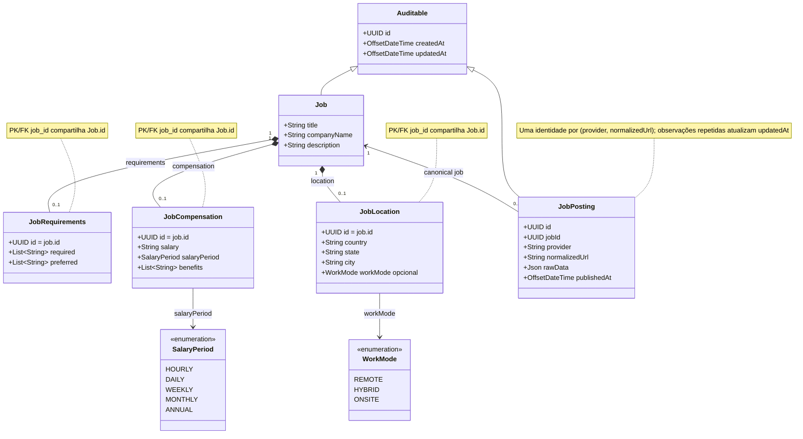
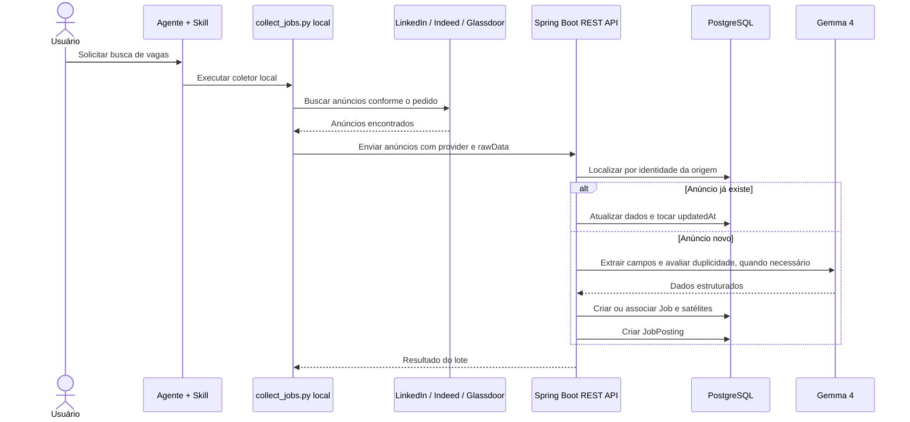

# Dianysma — Job Discovery

**Modelo de domínio proposto — anúncios únicos por provedor**

O coletor Python roda no cliente e envia anúncios à API. O módulo mantém uma publicação por anúncio de origem e associa publicações equivalentes a um `Job` canônico. Uma nova observação do mesmo anúncio atualiza o registro existente. O banco não registra execuções do coletor nem status de coleta ou processamento.

## Diagrama de classes

## Responsabilidades e relacionamentos

| Entidade | Responsabilidade |
|---|---|
| **Job** | Representa a oportunidade canônica. Publicações de provedores diferentes podem apontar para o mesmo `Job`. |
| **JobRequirements** | Requisitos obrigatórios e desejáveis do `Job`, armazenados como `TEXT[]`. |
| **JobCompensation** | Remuneração consolidada do `Job`: salário como texto, periodicidade e benefícios em `TEXT[]`. `salaryPeriod` assume `MONTHLY` por padrão e pode ficar nulo quando desconhecido. |
| **JobLocation** | Localização e modalidade consolidadas do `Job`. Se a modalidade for desconhecida, `workMode` fica nulo. |
| **JobPosting** | Um anúncio específico de um provedor, identificado por `(provider, normalizedUrl)`. Guarda a URL normalizada, a data de publicação e os dados recebidos em `rawData` (`JSONB`). `updatedAt` registra a observação mais recente. |

- `Job` possui zero ou uma tabela satélite de requisitos, remuneração e localização. Cada satélite usa `job_id` como PK e FK compartilhada com `Job.id` (`@MapsId`).
- Cada `JobPosting` pertence a exatamente um `Job`; um `Job` pode ter várias publicações, inclusive de provedores diferentes.
- `JobPosting.provider` é texto, por exemplo `linkedin`, `indeed` ou `glassdoor`.
- A identidade do anúncio é `(provider, normalizedUrl)`, garantida por uma constraint `UNIQUE` no banco. A normalização da URL deve ser consistente para cada provedor.
- Uma coleta repetida do mesmo anúncio atualiza os dados atuais e `updatedAt`, mesmo quando os demais dados não mudarem. A ingestão deve chamar `JobPosting.markObserved()` para tocar o timestamp; ela não cria outro `JobPosting`.
- Dois anúncios de provedores diferentes podem apontar para o mesmo `Job`. Anúncios distintos do mesmo provedor também podem ser associados ao mesmo `Job` se representarem a mesma oportunidade.
- `createdAt` registra a primeira persistência no servidor. Em `JobPosting`, `updatedAt` também representa o horário da observação mais recente; esse horário é gerado pelo servidor, não enviado pelo coletor.
- `rawData` guarda os dados estruturados recebidos do coletor, não exige HTML nem Object Storage. Definir limite de tamanho e retenção; não armazenar cookies, credenciais ou dados de sessão.
- O domínio não guarda `CollectionRun`, vínculo de anúncio com execução, status da coleta ou status de processamento do anúncio. Falhas do coletor são tratadas no cliente; erros da API são devolvidos ao cliente.

## Fluxo de ingestão

O contrato HTTP ainda será definido. A operação de ingestão recebe anúncios; cada item contém `provider`, `normalizedUrl`, `publishedAt` quando disponível e `rawData`. Reenviar um anúncio com a mesma identidade atualiza o mesmo registro e toca `updatedAt`, inclusive quando os dados forem iguais. O lote não precisa de um ID persistente de execução.
