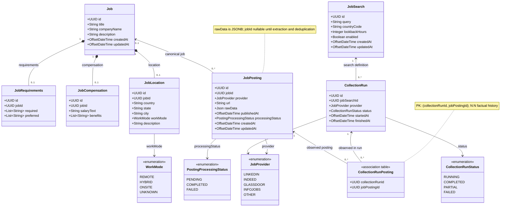

# Dianysma — Job Discovery

**Diagrama de classes (proposta v1.2 — coletor local e rawData JSONB)**

Módulo de descoberta de vagas no Brasil a partir de **um script Python local** acionado pelo agente usando a skill `dianysma`. O coletor consulta LinkedIn, Indeed e Glassdoor para pesquisas independentes de empresa, com janela de **24 horas**, e envia lotes JSON para a API. O backend executa normalização, extração assistida por IA, deduplicação entre plataformas e histórico normalizado das publicações encontradas por execução. Não inclui matching de candidatos, acompanhamento de candidatura ou pgvector para vagas.

## Diagrama Mermaid



## Responsabilidades das entidades

| Entidade | Responsabilidade |
|---|---|
| **Job** | Representa uma oportunidade de emprego canônica. Várias publicações da mesma oportunidade apontam para o mesmo Job. |
| **JobRequirements** | Dados dependentes de Job: listas de requisitos obrigatórios (`required`) e desejáveis (`preferred`), armazenadas como `TEXT[]` no PostgreSQL. |
| **JobCompensation** | Dados dependentes de Job: salário como texto e benefícios como lista (`TEXT[]`). |
| **JobLocation** | Dados dependentes de Job: país, estado, cidade, modalidade de trabalho e texto livre para restrições adicionais. |
| **JobPosting** | Representa um anúncio identificado por plataforma + URL normalizada. Guarda os **dados brutos recebidos do coletor** em `rawData` (coluna PostgreSQL `raw_data JSONB`), data de publicação e estado do processamento pela IA; não depende de HTML nem de Object Storage; possui `jobId` opcional até a deduplicação. |
| **JobSearch** | Configuração de uma pesquisa independente de empresa: consulta por palavras-chave, país, janela retroativa **padrão de 24 horas** e habilitação. O script pode lê-la pela API. |
| **CollectionRun** | Execução da coleta **no cliente Python** para uma JobSearch e um provedor de origem (LinkedIn, Indeed ou Glassdoor). A API recebe e persiste horários e status, sem contadores derivados. |
| **CollectionRunPosting** | Tabela associativa do N:N entre CollectionRun e JobPosting. Cada linha registra o fato de que determinada publicação apareceu naquela execução. Não possui contadores nem estado próprios. |

## Enumerações

- `WorkMode`: `REMOTE`, `HYBRID`, `ONSITE`, `UNKNOWN`.
- `JobProvider`: `LINKEDIN`, `INDEED`, `GLASSDOOR`, `INFOJOBS`, `OTHER` (somente os três primeiros são coletados no MVP).
- `PostingProcessingStatus`: `PENDING`, `COMPLETED`, `FAILED`.
- `CollectionRunStatus`: `RUNNING`, `COMPLETED`, `PARTIAL`, `FAILED`.

## Relacionamentos e integridade

- `Job` 1 — 0..1 `JobRequirements`, `JobCompensation` e `JobLocation` (cada satélite possui `job_id` obrigatório e `UNIQUE`).
- `Job` 0..1 — 0..* `JobPosting` (um anúncio pode aguardar associação; cada anúncio pertence no máximo a um Job).
- `JobSearch` 1 — 0..* `CollectionRun` (cada execução pertence a exatamente uma pesquisa).
- `CollectionRun` N:N `JobPosting` por `CollectionRunPosting`, cuja chave primária é `(collection_run_id, job_posting_id)`.
- `JobPosting` tem `UNIQUE(provider, normalized_url)` na implementação; o campo `url` deve ser salvo já normalizado, sem assumir que URLs diferentes nunca representem o mesmo anúncio.
- `CollectionRun.provider` e `JobPosting.provider` devem coincidir ao adicionar um vínculo em `CollectionRunPosting`; verificar na camada de aplicação ou com regra adicional no banco.
- `JobPosting.job_id` é opcional, mas deveria estar preenchido quando `processingStatus = COMPLETED` (constraint possível).
- `JobPosting.rawData` mapeia para `raw_data JSONB` (objeto JSON contendo os campos originais/normalizados que o coletor enviou, como título, empresa e descrição). O backend valida e limita o payload; o valor não representa necessariamente HTML. Não há dependência de Object Storage na coleta do MVP.
- `JobSearch.lookbackHours` possui padrão **24**; o cliente deve encaminhar essa janela ao coletor e não assumir que a filtragem de data dos portais seja perfeita.
- A API deve aceitar envios de lotes idempotentes. `CollectionRun.id` é o identificador estável da execução: reenvios com o mesmo ID não podem criar outra execução ou duplicar `CollectionRunPosting`. Cada `CollectionRun` mantém um único `provider`.
- Os valores `CollectionRun.provider` e `JobPosting.provider` representam **o portal de origem**, não a biblioteca JobSpy nem o meio de transporte HTTP.
- Tabelas satélites são opcionais porque nem sempre o anúncio informa remuneração, benefícios ou localização detalhada.

## Métricas calculadas, não persistidas

- **Encontradas na execução**: contar linhas de `CollectionRunPosting` para `collection_run_id`.
- **Novas na execução**: publicações cuja primeira execução vinculada seja a execução analisada (ordenar por `CollectionRun.startedAt` e por ID como desempate).
- **Repetidas entre execuções**: publicações já vinculadas a uma execução anterior.
- **Mesma vaga em plataformas diferentes**: dois ou mais `JobPosting` com o mesmo `job_id`.
- **Falhas**: o status da execução ou do processamento da publicação indica problemas; tentativas de download que falham **antes** de criar um `JobPosting` não são representadas pela relação N:N. Registrar detalhes nos logs ou evoluir o modelo se for necessário contá-las individualmente.

## Notas de implementação

1. `CollectionRunPosting` é uma tabela relacional **física**, não precisa ser uma entidade de domínio com lógica própria. Em JPA, pode ser implementada com `@ManyToMany` quando não tiver atributos adicionais.
2. `JobRequirements`, `JobCompensation` e `JobLocation` podem ser modeladas como componentes do agregado `Job` mesmo com tabelas próprias.
3. Não há campos `foundCount`, `newCount`, `duplicateCount`, `firstSeenAt`, `lastSeenAt`, `externalId` ou `contentHash` neste desenho.
4. `CollectionRun` e `JobPosting` mantêm status com significados distintos: sucesso/falha da execução e andamento da extração/associação de uma publicação.
5. Os dados estruturados em `Job` e satélites são extraídos prioritariamente dos campos determinísticos do `rawData`; Gemma 4 complementa informações quando necessário e ajuda a comparar duplicatas ambíguas. `rawData` permite reprocessamento enquanto retido.
6. Coleta apenas mediante execução de `scripts/collect_jobs.py` pela skill em ambiente local com suporte a Python; nenhum `Cloud Scheduler`, `Cloud Run Job` ou agendador local faz parte da arquitetura acordada.
7. Recebimento pela API REST: validação, limite por lote, autenticação, URL normalizada, upsert de `JobPosting`, associação a `CollectionRun` e processamento pela aplicação. O script não tem acesso ao banco nem executa IA. Reenvios devem ser seguros após falhas de rede. O transporte de anúncios em lotes limita tempo e tamanho de requisições.
8. Resultados de plataformas que bloqueiam ou limitam a coleta podem gerar `CollectionRunStatus.PARTIAL` ou `FAILED`; nunca presumir que o scraper obteve 100% das vagas.
9. `rawData` deve ter retenção/limites de tamanho definidos na implementação para controlar o armazenamento do Neon; não reter cookies, tokens, senhas ou dados de sessão.
10. O diagrama expressa cardinalidades de dados, não o momento exato em que um anúncio de vaga passa a ser considerado encerrado; o módulo não rastreia fechamento de vagas no MVP.


## Fluxo de ingestão na arquitetura atual

```mermaid
sequenceDiagram
    actor User as Usuário
    participant Agent as Agente e skill
    participant Py as collect_jobs.py local
    participant SRC as LinkedIn / Indeed / Glassdoor
    participant API as REST API Spring Boot
    participant DB as PostgreSQL
    participant AI as Gemma 4

    User->>Agent: Coletar vagas
    Agent->>Py: Iniciar execução do script
    opt Ambiente permite processo independente
        Agent-->>User: Coleta iniciada; encerrar turno
    end
    Py->>API: GET JobSearch habilitadas
    API-->>Py: Configurações da busca (24h)
    loop Para cada busca e portal
        Py->>SRC: Consultar anúncios conforme acesso permitido
        SRC-->>Py: Dados disponíveis
        Py->>API: POST lote JSON com runId e rawData
        API->>DB: Upsert JobPosting + CollectionRunPosting
        opt Anúncio novo ou alteração relevante
            API->>AI: Extrair dados faltantes e verificar duplicatas ambíguas
            AI-->>API: Dados extraídos / avaliação
            API->>DB: Criar ou associar Job e satélites
        end
        Py->>API: Finalizar CollectionRun (COMPLETED/PARTIAL/FAILED)
    end
```

**Contrato ilustrativo (não definitivo):** `GET /api/v1/job-searches?enabled=true` e `POST /api/v1/job-discovery/collections`, com `runId`, `jobSearchId`, `provider`, `postings[]`, `finalBatch` e `status` de fechamento quando aplicável. A API deve reconhecer o mesmo `runId` em envios repetidos. O endpoint pode aceitar múltiplos lotes do mesmo run sem adicionar entidades novas ao domínio.

Não são previstas tabelas adicionais de scraper ou de agendamento. O usuário aciona a skill quando quiser coletar.
